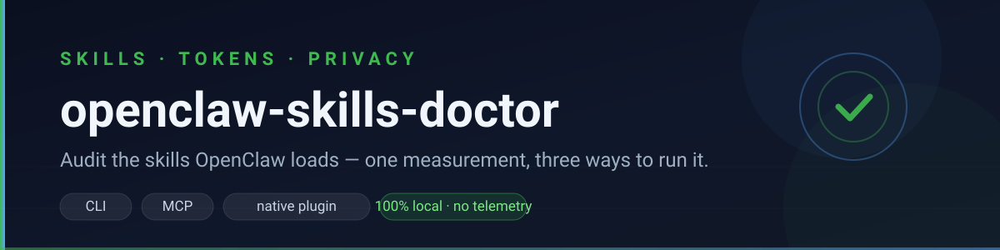
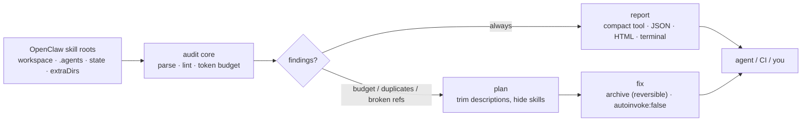

<p align="center">
  
</p>

<h1 align="center">openclaw-skills-doctor</h1>

<p align="center">
  <b>Audit the skills OpenClaw loads: per-step token cost, shadowed duplicates, broken references.</b><br>
  Then get a measured plan to trim or hide the expensive ones.
</p>

<p align="center">
  <a href="https://www.npmjs.com/package/openclaw-skills-doctor"></a>
  <a href="https://www.npmjs.com/package/openclaw-skills-doctor"></a>
  <a href="https://github.com/wangyuchen5110/openclaw-skills-doctor/stargazers"></a>
  <a href="https://github.com/wangyuchen5110/openclaw-skills-doctor/actions/workflows/test.yml"></a>
  <a href="LICENSE"></a>
  = 20">
</p>

<p align="center">
  
  
  
</p>

<p align="center">
  English · <a href="README.zh-CN.md">简体中文</a> · <a href="CHANGELOG.md">Changelog</a> · <a href="#privacy-local-only-no-data-collection">Privacy</a>
</p>

> **Runs 100% locally.** No telemetry, no account, no uploads — your skills,
> configuration and files never leave your machine. See [Privacy](#privacy-local-only-no-data-collection).

OpenClaw injects every eligible skill into the system prompt as a compact XML
block: roughly **97 characters plus name, description and location per skill,
paid on every model step**. This tool measures that cost, tells you which
definition actually wins, and can trim or hide the expensive ones.

Three ways to run it — **CLI**, **MCP server**, or the **native OpenClaw plugin**
(a `skills_doctor` tool + `/skills-doctor` command). All of them share the same
audit core, so the numbers always match.

## Contents

| | |
|---|---|
| [Quick start](#quick-start) · [Example output](#example-output) | [Privacy](#privacy-local-only-no-data-collection) · [What it audits](#what-it-audits) |
| [How it works](#how-it-works) · [Install](#install-the-integration) | [Native plugin](#native-plugin-optional) · [Paths](#paths-it-resolves) |
| [Commands](#commands) · [Fixing](#fixing-what-it-finds) | [Safety](#safety) · [Development](#development) |

## Quick start

```powershell
npx -y openclaw-skills-doctor check          # findings + per-step token cost
npx -y openclaw-skills-doctor plan           # exact savings: trim and/or hide
npx -y openclaw-skills-doctor doctor         # paths, roots, install state
npx -y openclaw-skills-doctor check --html openclaw-report.html --open
```

Nothing to configure: the wrapper resolves the state dir and workspace the same
way OpenClaw does.

Or install the companion skill from ClawHub:

```bash
openclaw skills install @wangyuchen5110/skills-doctor
```

### Example output

```text
$ npx -y openclaw-skills-doctor doctor
openclaw-skills-doctor doctor
  cli:        /usr/local/bin/openclaw
  state dir:  /home/you/.openclaw
  workspace:  /home/you/.openclaw/workspace
  config:     /home/you/.openclaw/openclaw.json

  skill roots:
    + /home/you/.openclaw/workspace/skills
    - /home/you/.openclaw/workspace/.agents/skills
    - /home/you/.agents/skills
    + /home/you/.openclaw/skills

  mcp entry:  saved
  bundled skill: installed
  native plugin: installed + enabled
  plugin dir: /home/you/.openclaw/extensions/openclaw-skills-doctor
```

## Privacy: local-only, no data collection

Everything runs on your machine. No telemetry, no analytics, no account, and
nothing is uploaded - not your skills, configuration or files.

| | |
|---|---|
| **Reads** | `openclaw.json` (only to locate `mcp.servers` / `plugins.entries`) and the skill files it audits (`SKILL.md` plus the resources they reference) |
| **Never reads** | chat history, sessions, transcripts, documents, source code, credentials or API keys |
| **Uploads** | nothing: there is no server component, and the wrapper itself makes no network calls |
| **Network** | none from the wrapper. The embedded core CLI (`skills-doctor`) may read the npm registry for a newer version once a day unless you disable it (`--no-update-check`, `SKILLS_DOCTOR_UPDATE_CHECK=0` or `"checkUpdates": "off"`) |
| **Writes** | only on `install`/`uninstall` (MCP entry in `openclaw.json` with a backup, the bundled skill under `<workspace>/skills`, an optional plugin under `<state-dir>/extensions`), and the HTML/JSON report you ask for |

`openclaw.json` can contain channel or provider credentials. It is parsed locally
only to find the entries this tool owns; values are never transmitted, printed or
copied into a report. Reports contain file paths and skill descriptions, never
file bodies. `check`, `plan`, `scan` and `doctor` work with the network offline.

## What it audits

OpenClaw file-backed skill roots, highest precedence first:

| Priority | Source | Path |
| --- | --- | --- |
| 1 | Workspace skills | `<workspace>/skills` |
| 2 | Project agent skills | `<workspace>/.agents/skills` |
| 3 | Personal agent skills | `~/.agents/skills` (default state dir only) |
| 4 | Managed / local skills | `<state-dir>/skills` |
| 5+ | Extra dirs | `skills.load.extraDirs` in `openclaw.json` |

The wrapper hands those roots to the core auditor in exactly this order, so the
winning definition in a shadowing report matches what OpenClaw actually loads.
Other agents' global roots (Claude, OpenCode, Grok, Cursor, Kimi, Hermes) are
skipped by default; pass `--include-other-agents` to audit them too.

## How it works



Every measurement is local and deterministic: the same skill files produce the
same numbers, so the report is safe to diff in CI.

## Install the integration

```powershell
npx -y openclaw-skills-doctor install
```

That does two things and is idempotent:

1. saves the MCP server definition `mcp.servers.skills-doctor` in
   `~/.openclaw/openclaw.json` by patching the config directly, with a
   timestamped backup (`openclaw.json.bak-<timestamp>`) and an atomic write. It
   never spawns the `openclaw` CLI, so it also works while the Gateway is
   running;
2. installs the bundled `openclaw-skills-doctor` skill into
   `<workspace>/skills/openclaw-skills-doctor`.

```powershell
npx -y openclaw-skills-doctor install --mcp-only     # just the MCP entry
npx -y openclaw-skills-doctor install --skill-only   # just the bundled skill
npx -y openclaw-skills-doctor install --plugin       # also the native plugin
npx -y openclaw-skills-doctor install --dry-run      # show what would change
npx -y openclaw-skills-doctor uninstall              # remove what install added
openclaw mcp doctor skills-doctor --probe            # verify the server connects
```

Restart the Gateway (or run `openclaw mcp reload`) so the tool appears. MCP tools
are namespaced per server, so the agent calls `skills-doctor__skills_doctor`.

## Native plugin (optional)

`install --plugin` copies the package into `<state-dir>/extensions/openclaw-skills-doctor`
and sets `plugins.entries["openclaw-skills-doctor"].enabled = true`. The plugin
adds:

- a `skills_doctor` tool that returns a **compact** report (top findings, budget
  line, next step) instead of the full markdown - tool results are paid in the
  model context too;
- a `/skills-doctor` command that prints the same report directly.

```powershell
openclaw plugins inspect openclaw-skills-doctor --runtime --json  # verify the load
```

Prefer a managed install for anything beyond local experiments:

```bash
openclaw plugins install ./openclaw-skills-doctor   # local package
```

The plugin API is **experimental**; pin your OpenClaw version and re-run
`openclaw plugins inspect ... --runtime` after upgrades. This repository ships
plain JavaScript with no build step (no TypeScript, no TypeBox), so the plugin
entry is the same code the tests exercise.

### Manual MCP setup

If you prefer to wire the MCP server yourself:

```bash
openclaw mcp add skills-doctor \
  --command npx \
  --arg -y \
  --arg opencode-skills-doctor \
  --arg mcp
```

or in `~/.openclaw/openclaw.json`:

```json5
{
  mcp: {
    servers: {
      "skills-doctor": {
        command: "npx",
        args: ["-y", "opencode-skills-doctor", "mcp"],
      },
    },
  },
}
```

## Paths it resolves

| What | Resolution order |
| --- | --- |
| State dir | `OPENCLAW_STATE_DIR` > `OPENCLAW_PROFILE` (`~/.openclaw-<profile>`) > `~/.openclaw` |
| Config | `<state-dir>/openclaw.json` |
| Workspace | `OPENCLAW_WORKSPACE_DIR` > `agents.entries.main.workspace` > `agents.defaults.workspace` > `<state-dir>/workspace` |

Override any of them with `--state-dir <dir>`, `--workspace <dir>`, `--home <dir>`.

## Commands

| Command | What it does |
| --- | --- |
| `check` | audit sources, shadowing, token budget and broken references (default) |
| `plan` | exact savings: which descriptions to trim, which skills to hide |
| `scan` | every skill with its source, precedence and cost |
| `fix` | archive shadowed duplicates (reversible) or hide low-frequency skills |
| `install` / `uninstall` | MCP entry + bundled skill (+ optional native plugin), idempotent |
| `doctor` | CLI, state dir, config, workspace, roots, MCP/skill/plugin install state |
| `mcp` | run the MCP server on stdio |

Core flags work as usual: `--json`, `--budget`, `--lang en|zh`, `--dry-run`,
`--strict`, `--html [file]`, `--no-global`.

## Fixing what it finds

```powershell
npx -y openclaw-skills-doctor plan             # measure first
npx -y openclaw-skills-doctor fix --dry-run    # see what would be archived
npx -y openclaw-skills-doctor fix              # archive shadowed duplicates (reversible)
npx -y openclaw-skills-doctor fix --hide legacy-skill
```

`fix` only archives definitions that never load, moving them to
`.skills-doctor-archive/<timestamp>/` inside the same skill root. `--hide` adds
`metadata.opencode/autoinvoke: false`, which keeps the skill loadable through an
explicit `@id` reference while removing it from the model-facing list.

## Safety

- **Local-only:** no telemetry, no backend, nothing leaves the machine; the only optional network call is the core CLI's daily npm version check, which you can disable.
- `check`, `plan`, `scan` and `doctor` are read-only and offline (no network, no LLM).
- `install`/`uninstall` back up `openclaw.json` before rewriting it, preserve
  its existing permission bits (credentials files are usually `0600`), and never
  spawn a child process.
- `uninstall` only removes a bundled skill when its `SKILL.md` was read
  successfully **and** still declares `name: openclaw-skills-doctor`; otherwise
  it leaves the directory in place with a warning.
- Config parsing understands JSON with comments and trailing commas. A file that
  uses other JSON5-only syntax (unquoted keys, single quotes) is reported, never
  rewritten - use `openclaw mcp add/set/unset` there instead.
- It is not a sandbox: it audits configuration and files, it does not constrain
  what the agent can do.

## Development

```powershell
npm install
npm test                  # 27 tests
npm run plugin:validate   # offline manifest/entry/metadata consistency
```

Requires Node >= 20. MIT.

[Changelog](CHANGELOG.md) · [中文说明](README.zh-CN.md) · [Core reference](https://github.com/wangyuchen5110/opencodeplugginprogram/blob/main/docs/REFERENCE.md)
