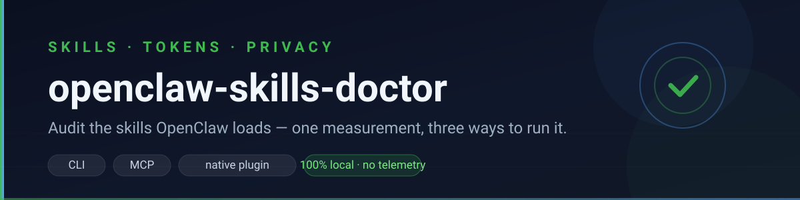
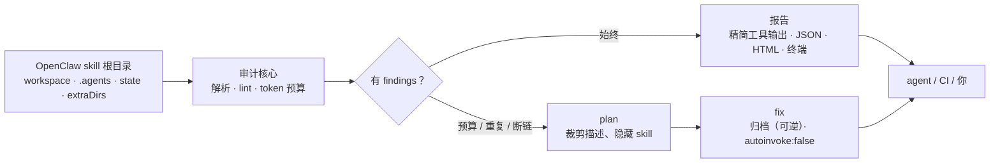

<p align="center">
  
</p>

<h1 align="center">openclaw-skills-doctor</h1>

<p align="center">
  <b>审计 OpenClaw 实际加载的 skills：每步 token 开销、被遮蔽的重复定义、断链引用。</b><br>
  并给出可量化的裁剪 / 隐藏方案。
</p>

<p align="center">
  <a href="https://www.npmjs.com/package/openclaw-skills-doctor"></a>
  <a href="https://www.npmjs.com/package/openclaw-skills-doctor"></a>
  <a href="https://github.com/wangyuchen5110/openclaw-skills-doctor/stargazers"></a>
  <a href="https://github.com/wangyuchen5110/openclaw-skills-doctor/actions/workflows/test.yml"></a>
  <a href="LICENSE"></a>
  = 20">
</p>

<p align="center">
  
  
  
</p>

<p align="center">
  <a href="README.md">English</a> · 简体中文 · <a href="CHANGELOG.md">变更记录</a> · <a href="#隐私纯本地运行不收集数据">隐私</a>
</p>

> **纯本地运行。** 无遥测、不需要账号、不上传 —— 你的 skill、配置和文件不会离开你的机器。见[隐私](#隐私纯本地运行不收集数据)。

OpenClaw 会把每个可用 skill 压成一段紧凑 XML 注入系统提示词：大约 **每个 skill 97 字符 + name/description/location 的长度，而且每个模型步骤都要付一次**。这个工具测量这笔开销、指出同一名字到底哪个定义生效，并能裁剪或隐藏昂贵的那些。

三种用法：**CLI**、**MCP server**、**原生 OpenClaw 插件**（`skills_doctor` 工具 + `/skills-doctor` 命令）。三者共用同一套审计核心，数字一致。

它是 [`opencode-skills-doctor`](https://github.com/wangyuchen5110/opencodeplugginprogram) 的一个聚焦封装，额外理解 OpenClaw 的 skill 根目录、优先级、`openclaw.json`、MCP 注册表和插件 API。

## 目录

| | |
|---|---|
| [快速开始](#快速开始) · [隐私](#隐私纯本地运行不收集数据) | [审计范围](#审计范围) · [工作原理](#工作原理) |
| [安装集成](#安装集成) · [原生插件](#原生插件可选) | [路径解析](#路径解析) · [命令](#命令) |

## 快速开始

```powershell
npx -y openclaw-skills-doctor check          # 体检 + 每步 token 开销
npx -y openclaw-skills-doctor plan           # 精确节省：裁剪/隐藏多少
npx -y openclaw-skills-doctor doctor         # 路径、根目录、安装状态
npx -y openclaw-skills-doctor check --html openclaw-report.html --open
```

无需配置：state 目录和 workspace 的解析规则与 OpenClaw 一致。

也可以直接从 ClawHub 装配套 skill：

```bash
openclaw skills install @wangyuchen5110/skills-doctor
```

### 示例输出

```text
$ npx -y openclaw-skills-doctor doctor
openclaw-skills-doctor doctor
  cli:        /usr/local/bin/openclaw
  state dir:  /home/you/.openclaw
  workspace:  /home/you/.openclaw/workspace
  config:     /home/you/.openclaw/openclaw.json

  skill roots:
    + /home/you/.openclaw/workspace/skills
    - /home/you/.openclaw/workspace/.agents/skills
    - /home/you/.agents/skills
    + /home/you/.openclaw/skills

  mcp entry:  saved
  bundled skill: installed
  native plugin: installed + enabled
  plugin dir: /home/you/.openclaw/extensions/openclaw-skills-doctor
```

## 隐私：纯本地运行，不收集数据

全部在你自己的机器上运行。没有遥测、没有统计、不需要账号，也不会把你的 skill、配置或文件上传到任何地方。

| | |
|---|---|
| **会读** | `openclaw.json`（只用来定位 `mcp.servers` / `plugins.entries`）以及被审计的 skill 文件（`SKILL.md` 及其引用的资源） |
| **不会读** | 对话历史、会话、会话记录、文档、源代码、凭据、API key |
| **不会上传** | 任何东西：没有服务端组件，封装层自身不发起任何网络请求 |
| **联网** | 封装层不联网。内嵌的核心 CLI（`skills-doctor`）每天最多查一次 npm registry 的最新版本号；可用 `--no-update-check`、`SKILLS_DOCTOR_UPDATE_CHECK=0` 或 `"checkUpdates": "off"` 关闭 |
| **会写** | 只在 `install`/`uninstall` 时写：`openclaw.json` 里的 MCP 条目（先备份）、`<workspace>/skills` 下的随包 skill、可选的 `<state-dir>/extensions` 插件；以及你主动要的 HTML/JSON 报告 |

`openclaw.json` 里可能有渠道/模型提供商的凭据；它只在本地被解析用来定位本工具自己的条目，值不会被传输、打印或写进报告。报告只含文件路径和 skill 描述，不含文件正文。`check`、`plan`、`scan`、`doctor` 都可以在断网环境运行。

## 审计范围

OpenClaw 文件型 skill 根目录，优先级从高到低：

| 优先级 | 来源 | 路径 |
| --- | --- | --- |
| 1 | 工作区 skills | `<workspace>/skills` |
| 2 | 项目 agent skills | `<workspace>/.agents/skills` |
| 3 | 个人 agent skills | `~/.agents/skills`（仅默认 state 目录） |
| 4 | 托管 / 本地 skills | `<state-dir>/skills` |
| 5+ | 额外目录 | `openclaw.json` 里的 `skills.load.extraDirs` |

封装层按这个顺序把目录交给核心审计器，所以遮蔽报告里的「生效版本」与 OpenClaw 运行时一致。默认不扫描其它 agent 的全局根目录（Claude / OpenCode / Grok / Cursor / Kimi / Hermes），需要时加 `--include-other-agents`。

## 工作原理



所有测量都在本地完成且结果确定：同样的 skill 文件得到同样的数字，所以报告可以直接放进 CI 做 diff。

## 安装集成

```powershell
npx -y openclaw-skills-doctor install
```

做两件事，且幂等：

1. 在 `~/.openclaw/openclaw.json` 写入 `mcp.servers.skills-doctor` —— 直接改配置，并保留 `openclaw.json.bak-<时间戳>` 备份、原子写入。**不会启动 `openclaw` CLI 子进程**，所以 Gateway 正在运行时也能装；
2. 把随包 skill 安装到 `<workspace>/skills/openclaw-skills-doctor`。

```powershell
npx -y openclaw-skills-doctor install --mcp-only     # 只写 MCP 条目
npx -y openclaw-skills-doctor install --skill-only   # 只装随包 skill
npx -y openclaw-skills-doctor install --plugin       # 同时装原生插件
npx -y openclaw-skills-doctor install --dry-run      # 只预览
npx -y openclaw-skills-doctor uninstall              # 撤销
openclaw mcp doctor skills-doctor --probe            # 验证 MCP 能连上
```

改完重启 Gateway（或 `openclaw mcp reload`）工具才会出现。MCP 工具按服务器加前缀，agent 里调用 `skills-doctor__skills_doctor`。

## 原生插件（可选）

`install --plugin` 会把包复制到 `<state-dir>/extensions/openclaw-skills-doctor`，并在配置里设 `plugins.entries["openclaw-skills-doctor"].enabled = true`。插件提供：

- `skills_doctor` 工具：返回**精简报告**（预算行 + top findings + 下一步），而不是完整 markdown —— 工具结果同样要占模型上下文；
- `/skills-doctor` 命令：直接打印同样的报告。

```powershell
openclaw plugins inspect openclaw-skills-doctor --runtime --json  # 验证加载
```

正式使用建议走受管安装：

```bash
openclaw plugins install ./openclaw-skills-doctor
```

插件 API 目前是 **experimental**：固定 OpenClaw 版本，升级后用 `openclaw plugins inspect ... --runtime` 复核。本仓库是纯 JavaScript、无构建步骤（不依赖 TypeScript / TypeBox），插件入口就是测试覆盖的同一份代码。

### 手动配置 MCP

```bash
openclaw mcp add skills-doctor \
  --command npx \
  --arg -y \
  --arg opencode-skills-doctor \
  --arg mcp
```

## 路径解析

| 项目 | 优先级 |
| --- | --- |
| state 目录 | `OPENCLAW_STATE_DIR` > `OPENCLAW_PROFILE`（`~/.openclaw-<profile>`）> `~/.openclaw` |
| 配置文件 | `<state-dir>/openclaw.json` |
| workspace | `OPENCLAW_WORKSPACE_DIR` > `agents.entries.main.workspace` > `agents.defaults.workspace` > `<state-dir>/workspace` |

可用 `--state-dir <dir>`、`--workspace <dir>`、`--home <dir>` 覆盖。

## 命令

| 命令 | 作用 |
| --- | --- |
| `check` | 审计来源、遮蔽、token 预算、断链（默认命令） |
| `plan` | 精确节省：裁剪哪些描述、隐藏哪些 skill |
| `scan` | 列出每个 skill 的来源、优先级、成本 |
| `fix` | 归档被遮蔽定义（可逆）或隐藏低频 skill |
| `install` / `uninstall` | MCP 条目 + 随包 skill（+ 可选原生插件），幂等 |
| `doctor` | CLI、state、配置、workspace、根目录、MCP/skill/插件安装状态 |
| `mcp` | 以 stdio 方式运行 MCP server |

核心参数照常可用：`--json`、`--budget`、`--lang en|zh`、`--dry-run`、`--strict`、`--html [file]`、`--no-global`。

## 修复

```powershell
npx -y openclaw-skills-doctor plan             # 先量化
npx -y openclaw-skills-doctor fix --dry-run    # 预览会归档什么
npx -y openclaw-skills-doctor fix              # 归档被遮蔽定义（可逆）
npx -y openclaw-skills-doctor fix --hide legacy-skill
```

`fix` 只归档永远不会生效的定义，移到同目录下的 `.skills-doctor-archive/<时间戳>/`。`--hide` 会写 `metadata.opencode/autoinvoke: false`：从模型可见列表移除，但仍可用 `@id` 显式加载。

## 安全

- **纯本地**：无遥测、无后端，数据不出机器；唯一可选的联网是核心 CLI 每天一次的 npm 版本检查，可关闭。
- `check` / `plan` / `scan` / `doctor` 只读、离线（不联网、不调模型）。
- `install` / `uninstall` 改 `openclaw.json` 前先备份、保留原文件权限位（凭据文件通常是 `0600`），且**不会启动任何子进程**。
- `uninstall` 只有在成功读到 `SKILL.md` 且其中仍声明 `name: openclaw-skills-doctor` 时才删随包 skill；读不到就保留目录并给出警告。
- 配置解析支持注释和尾逗号；遇到其它 JSON5 专有语法（无引号 key、单引号）只报告不重写 —— 这种情况请用 `openclaw mcp add/set/unset`。
- 它不是沙箱：只审计配置和文件，不限制 agent 能做什么。

## 开发

```powershell
npm install
npm test        # 27 个测试
```

需要 Node >= 20。MIT。

[变更记录](CHANGELOG.md) · [English](README.md) · [核心参考](https://github.com/wangyuchen5110/opencodeplugginprogram/blob/main/docs/REFERENCE.md)
